<p align="center">
  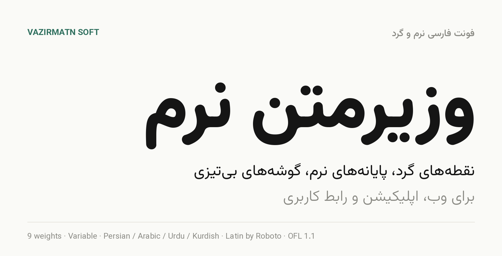
</p>

<p align="center"><a href="README.md">English</a> · <b>فارسی</b></p>

<div dir="rtl" align="right">

# وزیرمتن نرم

**وزیرمتن نرم** نسخه‌ای نرم و گرد از [وزیرمتن](https://github.com/rastikerdar/vazirmatn)، فونت فارسی/عربی **صابر راستی‌کردار**، است. نقطه‌ها گرد شده‌اند، پایانهٔ حرکت‌ها گرد است و گوشه‌های تیز نرم شده‌اند؛ در هر ۹ وزن و فونت متغیر. شکل حروف، فاصله‌گذاری، اتصال‌ها، کرنینگ و پشتیبانی زبان‌ها همان وزیرمتن است.

به یاد صابر راستی‌کردار و با احترام به کار او.

[دریافت](https://github.com/truthofmatthew/vazirmatn-soft/releases/latest) · [نصب](#نصب) · [استفاده در وب](#استفاده-در-وب) · [وزن‌ها](#وزن‌ها) · [جزئیات طراحی](#جزئیات-طراحی) · [مجوز](#سازندگان-و-مجوز)

</div>

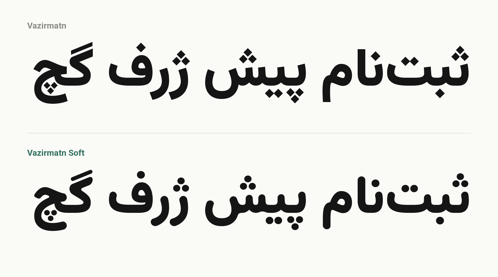

<div dir="rtl" align="right">

## نصب

آخرین فایل zip را از بخش [**Releases**](https://github.com/truthofmatthew/vazirmatn-soft/releases/latest) دریافت کنید، یا فایل‌ها را مستقیم از همین مخزن بردارید.

- **مک:** فایل‌های پوشهٔ `fonts/ttf` را باز کنید و *Install Font* را بزنید (یا آن‌ها را در Font Book بکشید).
- **ویندوز:** فایل‌های `fonts/ttf` را انتخاب کنید، کلیک راست و *Install*.
- **لینوکس:** فایل‌های `fonts/ttf/*.ttf` را در `~/.local/share/fonts/` کپی کنید و `fc-cache -f` را اجرا کنید.

نام خانواده **Vazirmatn Soft** است، پس کنار وزیرمتن اصلی نصب می‌شود و جای آن را نمی‌گیرد. یا وزن‌های ثابت (`fonts/ttf`) را نصب کنید یا فونت متغیر (`fonts/variable`)؛ نه هر دو را، چون نام‌های داخلی یکسانی دارند.

## استفاده در وب

فونت متغیر همهٔ وزن‌ها از ۱۰۰ تا ۹۰۰ را در یک فایل دارد. این را به CSS خود اضافه کنید:

</div>

```css
@font-face {
  font-family: 'Vazirmatn Soft';
  src: url('https://cdn.jsdelivr.net/gh/truthofmatthew/vazirmatn-soft@v1.1.1/fonts/webfonts/VazirmatnSoft%5Bwght%5D.woff2') format('woff2');
  font-weight: 100 900;
  font-style: normal;
  font-display: swap;
}

body {
  font-family: 'Vazirmatn Soft', sans-serif;
}
```

<div dir="rtl" align="right">

اگر فایل جداگانه برای هر وزن می‌خواهید، برای هر وزنی که لازم دارید یک `@font-face` اضافه کنید:

</div>

```css
@font-face {
  font-family: 'Vazirmatn Soft';
  src: url('https://cdn.jsdelivr.net/gh/truthofmatthew/vazirmatn-soft@v1.1.1/fonts/webfonts/VazirmatnSoft-Regular.woff2') format('woff2');
  font-weight: 400;
  font-display: swap;
}

@font-face {
  font-family: 'Vazirmatn Soft';
  src: url('https://cdn.jsdelivr.net/gh/truthofmatthew/vazirmatn-soft@v1.1.1/fonts/webfonts/VazirmatnSoft-Bold.woff2') format('woff2');
  font-weight: 700;
  font-display: swap;
}
```

<div dir="rtl" align="right">

برای میزبانی روی سایت خودتان، پوشهٔ `fonts/webfonts` را روی سایت کپی کنید و آدرس `url()` را به آن بدهید.

## وزن‌ها

</div>

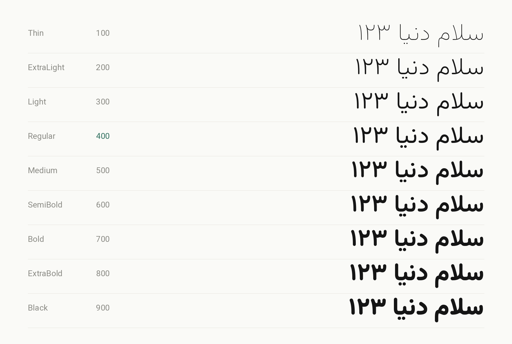

<div dir="rtl" align="right">

| وزن | `font-weight` | فایل |
|---|---|---|
| Thin (نازک) | ۱۰۰ | `VazirmatnSoft-Thin` |
| ExtraLight | ۲۰۰ | `VazirmatnSoft-ExtraLight` |
| Light (سبک) | ۳۰۰ | `VazirmatnSoft-Light` |
| Regular (معمولی) | ۴۰۰ | `VazirmatnSoft-Regular` |
| Medium (متوسط) | ۵۰۰ | `VazirmatnSoft-Medium` |
| SemiBold | ۶۰۰ | `VazirmatnSoft-SemiBold` |
| Bold (ضخیم) | ۷۰۰ | `VazirmatnSoft-Bold` |
| ExtraBold | ۸۰۰ | `VazirmatnSoft-ExtraBold` |
| Black (سیاه) | ۹۰۰ | `VazirmatnSoft-Black` |

### نسخه‌ها

پوشهٔ `misc` همان نسخه‌های وزیرمتن را دارد؛ هر کدام با نام خانوادهٔ جدا، تا بتوان کنار نسخهٔ اصلی از آن استفاده کرد:

| پوشه | نام خانواده | توضیح |
|---|---|---|
| `UI` | Vazirmatn Soft UI | فاصلهٔ خطوط کمتر، برای دکمه‌ها، منوها و متن‌های رابط کاربری |
| `Non-Latin` | Vazirmatn Soft NL | فقط فارسی/عربی، بدون حروف لاتین (فایل کوچک‌تر؛ آن را با فونت لاتین دلخواه خود همراه کنید) |
| `Farsi-Digits` | Vazirmatn Soft FD | اعداد لاتین ۰ تا ۹ به‌صورت اعداد فارسی نمایش داده می‌شوند |
| `UI-Non-Latin`، `UI-Farsi-Digits`، `Farsi-Digits-Non-Latin`، `UI-Farsi-Digits-Non-Latin` | Vazirmatn Soft UI NL، UI FD، FD NL، UI FD NL | ترکیب نسخه‌های بالا |

### در عمل

</div>

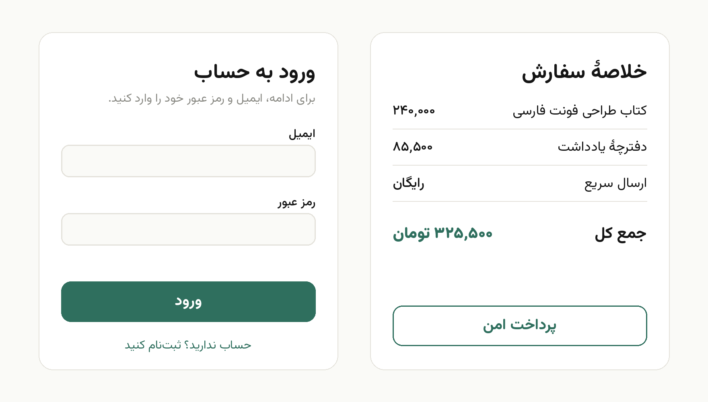

<div dir="rtl" align="right">

## قابلیت‌های OpenType

همهٔ این‌ها در همان یک فایل فونت هست. با CSS روشنشان کنید، یا از پنل OpenType در فیگما، ایلاستریتور و ایندیزاین.

| چه چیزی | چطور | CSS |
|---|---|---|
| تومانِ فشرده | «تومان» و بعد «ء» را تایپ کنید (با نیم‌فاصله قبل از ء هم کار می‌کند) | پیش‌فرض روشن است |
| ریالِ فشرده | «ریال» و بعد «ء» | پیش‌فرض روشن است |
| تومانِ دوخطی | تومان فشرده همراه `ss02` | `font-feature-settings: "ss02";` |
| تومانِ باریک | `salt`، شکل دوم | `font-feature-settings: "salt" 2;` |
| اعداد فارسی به‌جای اعداد لاتین | `ss01` | `font-feature-settings: "ss01";` |
| اعداد پایین‌تر از کرسی | `ss03` | `font-feature-settings: "ss03";` |
| اعداد هم‌عرض (جدولی) | `tnum` | `font-variant-numeric: tabular-nums;` |
| «ه» پایانی به سبک نستعلیق | `ss04` | `font-feature-settings: "ss04";` |
| کشیده | بین حروف «ـ» تایپ کنید | |

در برنامه‌هایی که قابلیت OpenType ندارند، شکل‌های فشرده را مستقیم تایپ کنید: U+E000 (تومان)، U+E001 (تومان دوخطی)، U+E002 (تومان باریک)، U+E003 (ریال).

می‌شود چند قابلیت را با هم روشن کرد؛ مثلاً برای قیمت‌ها با اعداد فارسی و هم‌عرض: `font-feature-settings: "ss01", "tnum";`. بستهٔ npm این‌ها را به شکل کلاس‌های آماده در `features.css` دارد.

## جزئیات طراحی

هر تصویر یک حرف را در وزیرمتن (چپ) و وزیرمتن نرم (راست) همان‌طور نشان می‌دهد که طراح فونت می‌بیند: مربع‌ها نقطه‌های روی منحنی‌اند و دایره‌ها نقطه‌های کنترل با دسته‌هایشان. در طرف وزیرمتن نرم، خط نازک قرمز طرح اصلی وزیرمتن است تا هر تغییر دیده شود.

همهٔ تغییرها با قاعده‌های یکسان روی سه طرح اصلی وزیرمتن (Thin، Regular و Black) اعمال شده‌اند، پس وزن‌های میانی و فونت متغیر بی‌نقص ساخته می‌شوند. اندازهٔ هر قاعده به ضخامت حرکت در همان وزن بستگی دارد، پس Thin و Black به یک نسبت نرم شده‌اند.

**نقطه‌ها.** نقطه‌های لوزی جای خود را به دایره‌هایی با همان وزن دیداری و در همان جایگاه داده‌اند؛ برای نقطه‌های تکی، دوتایی و سه‌تایی بالا و پایین حروف (ب پ ت ث ج چ ژ ش ...) و نقطه‌های درون نشانه‌های دیگر.

</div>

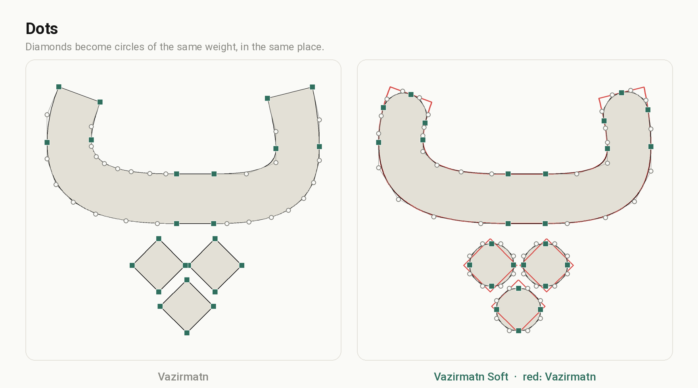

<div dir="rtl" align="right">

**پایانهٔ حرکت‌ها.** جایی که حرکت با برش صاف تمام می‌شود، برش به نیم‌دایره تبدیل شده است. گردی *داخل* خود حرکت کشیده شده، پس ارتفاع، عرض و فاصله‌گذاری حروف تغییر نمی‌کند و طول سطرها همان طول وزیرمتن می‌ماند. برش‌های مورب (انتهای ر، دنبالهٔ ی، سر ک) هم به همین شکل گرد شده‌اند.

</div>

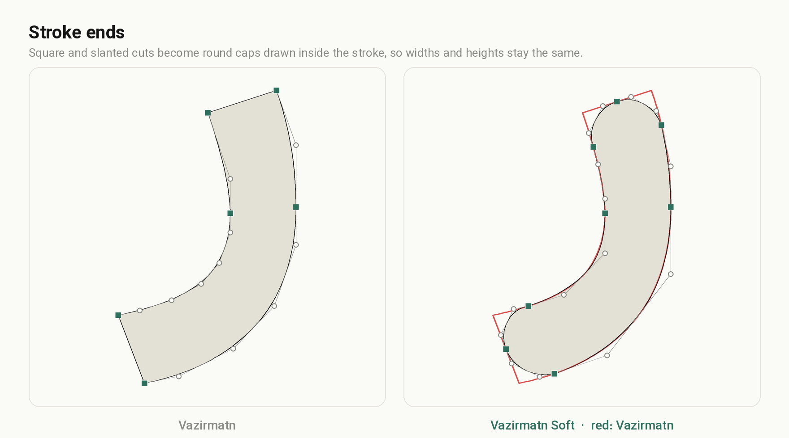

<div dir="rtl" align="right">

**گوشه‌های بیرونی.** گوشه‌های بیرونی باقی‌مانده انحنای کوچکی به اندازهٔ یک‌چهارم ضخامت حرکت گرفته‌اند؛ مانند سر ه و ک و گوشه‌های اعداد و نشانه‌ها.

</div>

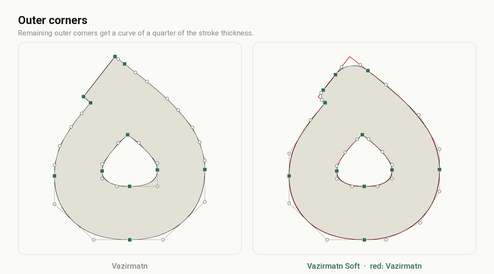

<div dir="rtl" align="right">

**گوشه‌های درونی.** جایی که دو حرکت صاف از درون به هم می‌رسند، مثلاً داخل سر ک، گوشه انحنای کوچک‌تری (یک‌ششم ضخامت حرکت) گرفته است تا فضاهای خالی نرم دیده شوند ولی پر نشوند.

</div>

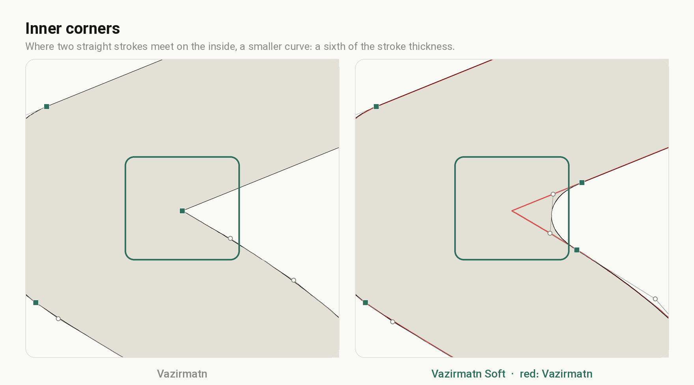

<div dir="rtl" align="right">

**محل اتصال کاسه به خط کرسی.** جایی که کاسهٔ منحنی به حرکت صاف خط کرسی می‌رسد (زیر ش، ص، ن و حروف مشابه)، انحنای نرم‌کننده هم‌جهت با کاسه است، پس بدون پله یا زائده در آن جاری می‌شود.

</div>

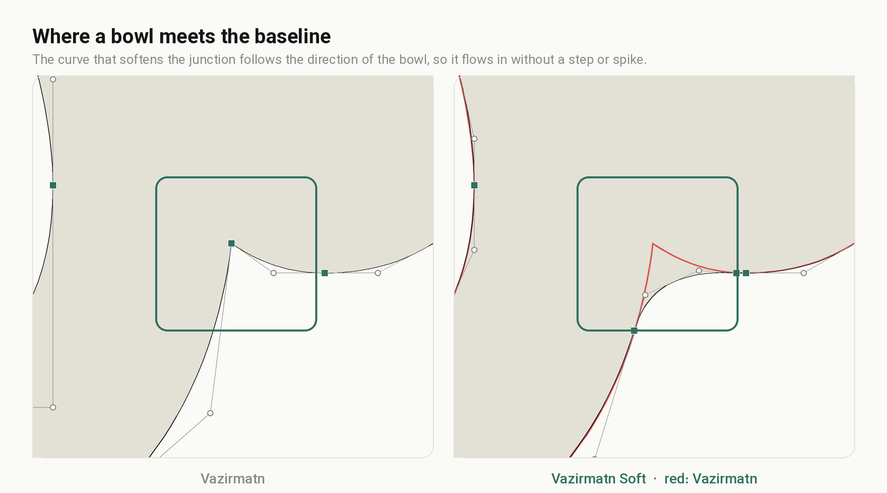

<div dir="rtl" align="right">

**لبه‌های اتصال حروف تیز می‌مانند.** حروف فارسی روی خط کرسی به هم وصل می‌شوند. لبه‌هایی که یک حرف به حرف بعد می‌رسد هرگز گرد نمی‌شوند، چون گردی آن‌جا به شکل بریدگی میان حروف دیده می‌شد. قطعه‌های کوتاه اتصال در شکل‌هایی مانند پـ آغازی، ـیـ میانی و ـر پایانی هم تیز مانده‌اند، تا واژه‌هایی مانند «پیش»، «وزیرمتن» و «نرم» در همهٔ وزن‌ها یکپارچه به هم بپیوندند. گوشه‌هایی هم که درون حرکت دیگری پنهان‌اند دست‌نخورده مانده‌اند، چون گرد کردنشان فرورفتگی ایجاد می‌کرد.

</div>

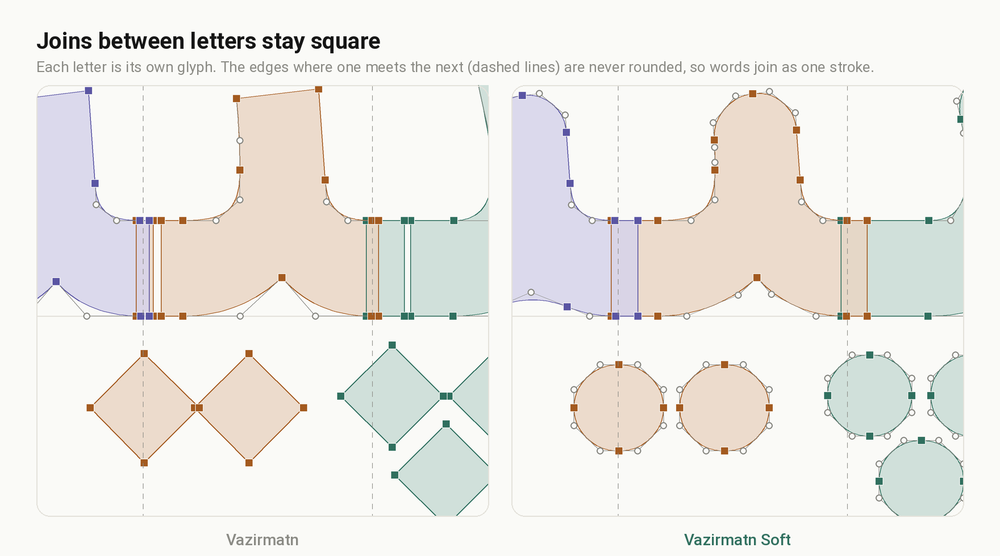

<div dir="rtl" align="right">

**همپوشانی بیشتر در محل اتصال.** هر حرف پیوسته یک گلیف جداست و حروف کنار هم در محل اتصال کمی روی هم می‌افتند. بعضی نرم‌افزارها هر گلیف را جدا رسم می‌کنند و اگر این همپوشانی کمتر از یک پیکسل باشد، در اندازه‌های کوچک خط کم‌رنگی در محل اتصال دیده می‌شود؛ در وزیرمتن اصلی هم همین‌طور است. در وزیرمتن نرم، حرکت اتصالی که از سمت راست می‌آید به جای ۲۰ واحد، ۶۴ واحد زیر حرف بعدی می‌رود. این عمق اندازه‌گیری شده تا در همهٔ وزن‌ها درون حرف بعدی پنهان بماند و چیز تازه‌ای دیده نشود. لبه‌های سمت دیگر همان ۲۰ واحد وزیرمتن را دارند، چون بعضی حروف (مانند م پایانی) فقط تا همین عمق توپُر هستند.

</div>

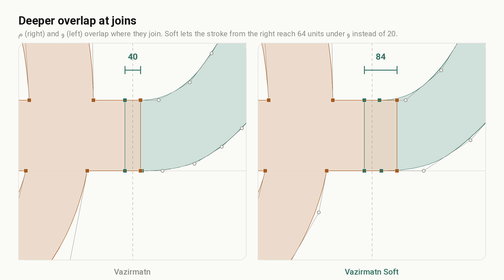

<div dir="rtl" align="right">

**دنبالهٔ کاسه‌ها.** نوک دنبالهٔ س ش ص ض ن ی ل ق (شکل‌های تنها و پایانی) کمی پایین‌تر است، تا کاسه‌ها گردتر دیده شوند.

</div>

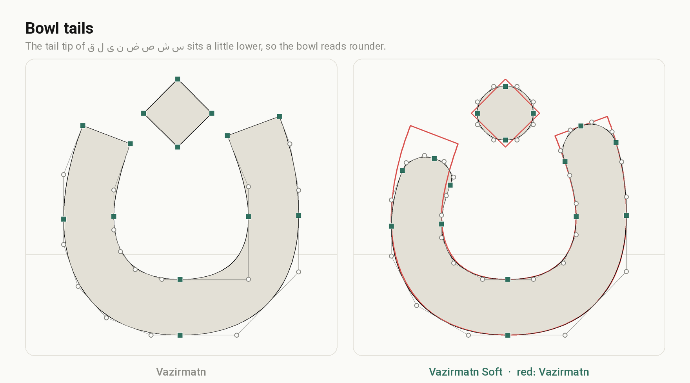

<div dir="rtl" align="right">

**سرکش گ.** سرکش دوم گ به جای متوازی‌الاضلاع مورب، کپسولی با دو سر گرد است.

</div>

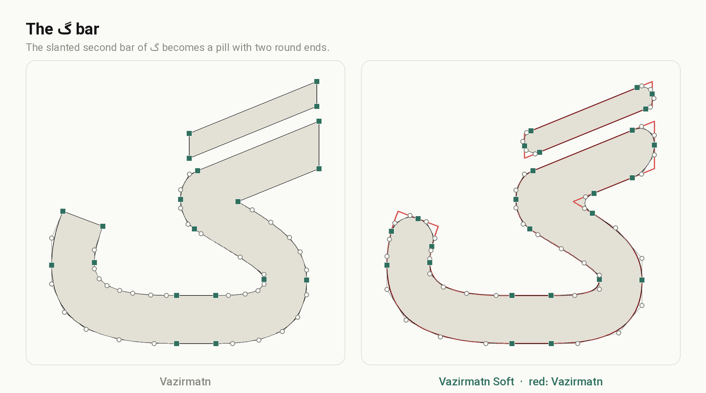

<div dir="rtl" align="right">

**اعداد و نشانه‌ها.** ۰ تا ۹، « »، / ٪ ! ؟ و نشانه‌های دیگر همان پایانه‌های گرد و گوشه‌های نرم حروف را دارند.

</div>

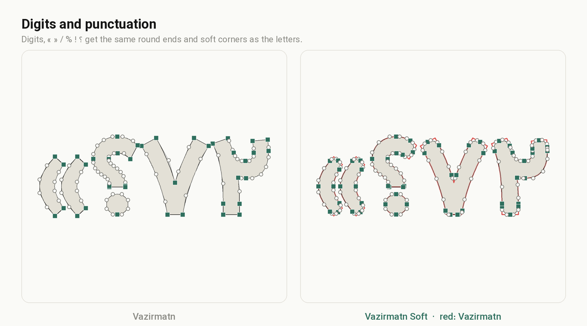

<div dir="rtl" align="right">

**بدون تغییر ماندند.** کشیده (ـ) صاف مانده تا بتواند حروف را بدون برآمدگی بکشد. ستاره ٭ و ۍ پایانی شکل اصلی خود را دارند، چون گرد کردنشان در بعضی وزن‌های میانی باعث روی‌هم‌افتادن خطوطشان می‌شد.

**دست‌نخورده.** اتصال‌ها، لیگاتورها، کرنینگ، جای اعراب، پشتیبانی فارسی، عربی، اردو و کردی، و حروف لاتین (از Roboto) دقیقاً همان وزیرمتن است.

**بررسی‌شده.** همهٔ وزن‌ها بررسی‌های عمومی FontBakery را بدون خطا می‌گذرانند، هیچ خط روی‌هم‌افتاده‌ای ندارند و به گزارش Shaperglot از فارسی به‌طور کامل پشتیبانی می‌کنند.

## سازندگان و مجوز

- **وزیرمتن** اثر [صابر راستی‌کردار](https://github.com/rastikerdar/vazirmatn).
- **حروف لاتین** از [Roboto](https://github.com/googlefonts/roboto-classic) اثر کریستین رابرتسون.
- **وزیرمتن نرم** اثر [متیو](https://github.com/truthofmatthew).

این فونت مانند وزیرمتن تحت مجوز [SIL Open Font License 1.1](OFL.txt) منتشر شده است: استفاده در کارهای شخصی و تجاری، تغییر و انتشار آن آزاد است؛ نسخه‌های تغییریافته هم باید تحت همین مجوز بمانند و فروش خود فونت به‌تنهایی مجاز نیست.

</div>
