<p align="center">
  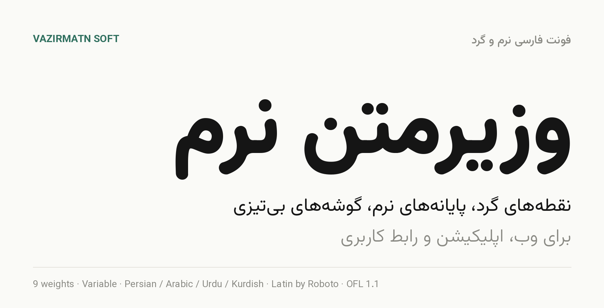
</p>

<p align="center"><b>English</b> · <a href="README.fa.md">فارسی</a></p>

# Vazirmatn Soft

**Vazirmatn Soft** is a soft, rounded version of [Vazirmatn](https://github.com/rastikerdar/vazirmatn), the Persian/Arabic typeface by **Saber Rastikerdar**. The dots are round, stroke ends are round and sharp corners are softened, in all nine weights and the variable font. The letterforms, spacing, shaping, kerning and language support are Vazirmatn's.

I made it for my own projects first, then decided to share it. Dedicated to the memory of Saber Rastikerdar, with respect for his work.

[Download](https://github.com/truthofmatthew/vazirmatn-soft/releases/latest) · [Install](#install) · [Use on the web](#use-on-the-web) · [Weights](#weights) · [Design details](#design-details) · [License](#credits-and-license)

<p align="center">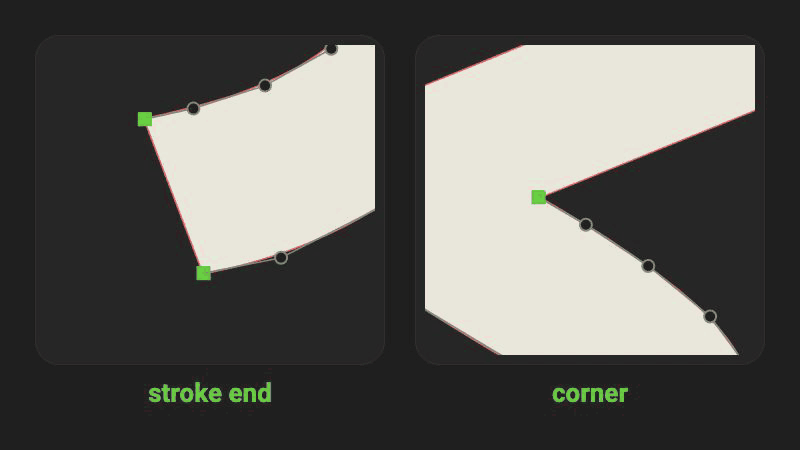</p>

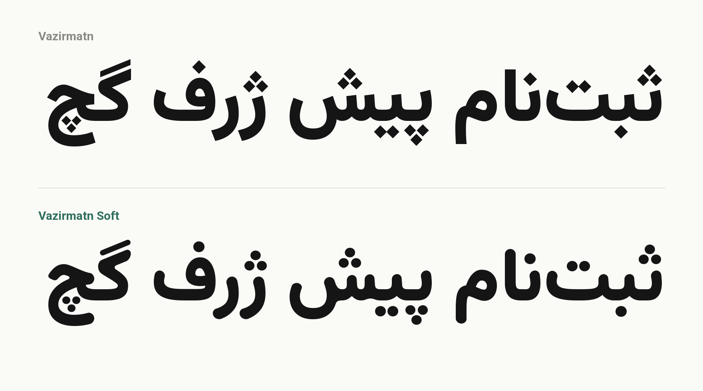

## Install

Download the latest zip from [**Releases**](https://github.com/truthofmatthew/vazirmatn-soft/releases/latest), or take the files straight from this repository.

- **macOS:** open the files in `fonts/ttf/` and click *Install Font* (or drag them into Font Book).
- **Windows:** select the files in `fonts/ttf/`, right-click, *Install*.
- **Linux:** copy `fonts/ttf/*.ttf` to `~/.local/share/fonts/` and run `fc-cache -f`.

The family is called **Vazirmatn Soft**, so it installs next to the original Vazirmatn without replacing it. Install either the static weights in `fonts/ttf/` or the variable font in `fonts/variable/`, not both: they share internal names.

## Use on the web

The variable font has every weight from 100 to 900 in one file. Add this to your CSS:

```css
@font-face {
  font-family: 'Vazirmatn Soft';
  src: url('https://cdn.jsdelivr.net/gh/truthofmatthew/vazirmatn-soft@v1.1.2/fonts/webfonts/VazirmatnSoft%5Bwght%5D.woff2') format('woff2');
  font-weight: 100 900;
  font-style: normal;
  font-display: swap;
}

body {
  font-family: 'Vazirmatn Soft', sans-serif;
}
```

To use separate files per weight instead, add one `@font-face` for each weight you need:

```css
@font-face {
  font-family: 'Vazirmatn Soft';
  src: url('https://cdn.jsdelivr.net/gh/truthofmatthew/vazirmatn-soft@v1.1.2/fonts/webfonts/VazirmatnSoft-Regular.woff2') format('woff2');
  font-weight: 400;
  font-display: swap;
}

@font-face {
  font-family: 'Vazirmatn Soft';
  src: url('https://cdn.jsdelivr.net/gh/truthofmatthew/vazirmatn-soft@v1.1.2/fonts/webfonts/VazirmatnSoft-Bold.woff2') format('woff2');
  font-weight: 700;
  font-display: swap;
}
```

To host the files yourself, copy `fonts/webfonts/` to your site and point `url()` at your copy.

## Weights

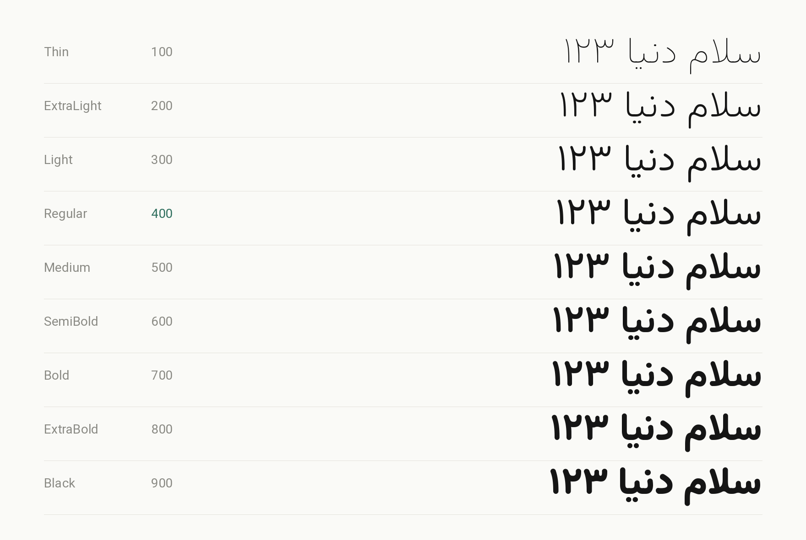

| Weight | `font-weight` | File |
|---|---|---|
| Thin | 100 | `VazirmatnSoft-Thin` |
| ExtraLight | 200 | `VazirmatnSoft-ExtraLight` |
| Light | 300 | `VazirmatnSoft-Light` |
| Regular | 400 | `VazirmatnSoft-Regular` |
| Medium | 500 | `VazirmatnSoft-Medium` |
| SemiBold | 600 | `VazirmatnSoft-SemiBold` |
| Bold | 700 | `VazirmatnSoft-Bold` |
| ExtraBold | 800 | `VazirmatnSoft-ExtraBold` |
| Black | 900 | `VazirmatnSoft-Black` |

### Editions

The `misc/` folder has the same editions as Vazirmatn, each as its own family so it can be used next to the main one:

| Folder | Family name | What it is |
|---|---|---|
| `UI` | Vazirmatn Soft UI | Tighter line height for buttons, menus and other interface text |
| `Non-Latin` | Vazirmatn Soft NL | Persian/Arabic only, without Latin letters (smaller files; pair it with your own Latin font) |
| `Farsi-Digits` | Vazirmatn Soft FD | Latin digits 0–9 are shown as Persian digits ۰–۹ |
| `UI-Non-Latin`, `UI-Farsi-Digits`, `Farsi-Digits-Non-Latin`, `UI-Farsi-Digits-Non-Latin` | Vazirmatn Soft UI NL, UI FD, FD NL, UI FD NL | Combinations of the above |

### In use

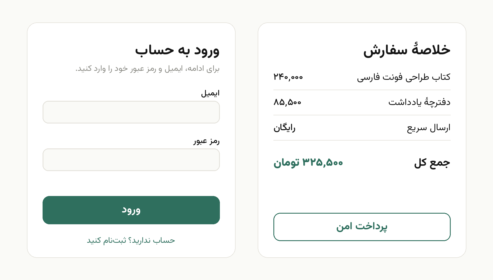

## OpenType features

One font file covers all of these. Turn them on with CSS, or from the OpenType panel in Figma, Illustrator or InDesign.

| What | How | CSS |
|---|---|---|
| Compact تومان | type «تومان» then «ء» (a ZWNJ before ء also works) | on by default |
| Compact ریال | type «ریال» then «ء» | on by default |
| Two-line تومان | compact تومان with `ss02` | `font-feature-settings: "ss02";` |
| Condensed تومان | `salt`, second alternate | `font-feature-settings: "salt" 2;` |
| Persian digits from Latin digits | `ss01` | `font-feature-settings: "ss01";` |
| Lowered digits | `ss03` | `font-feature-settings: "ss03";` |
| Tabular (fixed-width) digits | `tnum` | `font-variant-numeric: tabular-nums;` |
| Nastaliq-style final ه | `ss04` | `font-feature-settings: "ss04";` |
| Kashida stretch | type ـ between letters | |

Apps that can't apply OpenType features can type the compact forms directly: U+E000 (تومان), U+E001 (two-line تومان), U+E002 (condensed تومان), U+E003 (ریال).

Combine features in one rule, for example prices with Persian, fixed-width digits: `font-feature-settings: "ss01", "tnum";`. The npm package ships these as ready classes in `features.css`.

## Design details

Each figure shows the same glyph in Vazirmatn (left) and Vazirmatn Soft (right) as a type designer sees it: squares are on-curve points, circles are off-curve control points with their handles. On the Soft side, the thin red line is the original Vazirmatn outline, so every change is visible.

Every change is made to Vazirmatn's three masters (Thin, Regular, Black) with the same rules, so the weights in between and the variable font interpolate cleanly. Each rule is sized by the stroke thickness of its weight, so Thin and Black get the same look in proportion.

**Dots.** The diamond dots are replaced by circles of the same visual weight, in the same positions. This covers single, double and triple dots above and below (ب پ ت ث ج چ ژ ش ...), and the dots inside other marks.

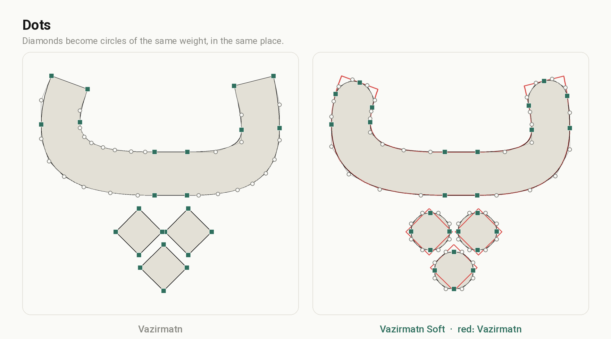

**Stroke ends.** Where a stroke ends with a square cut, the cut becomes a half-circle. The round cap is drawn *inside* the stroke, so a letter's height, width and spacing don't change and lines of text keep the same length as with Vazirmatn. Slanted cuts (the end of ر, the tail of ی, the top of ک) are rounded the same way.

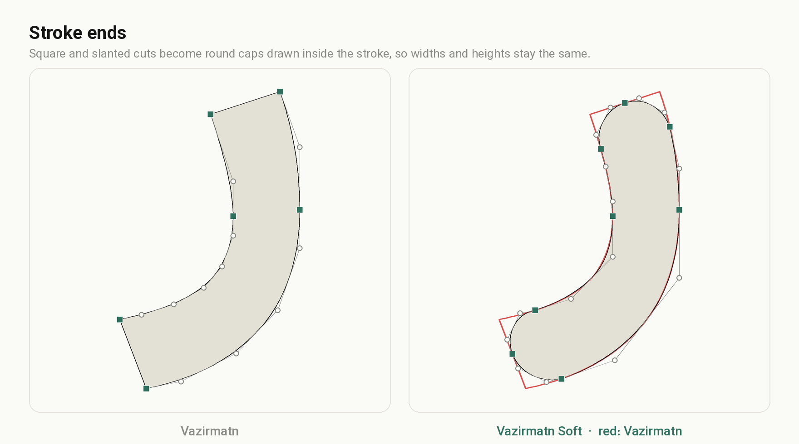

**Outer corners.** Remaining outer corners get a small curve, a quarter of the stroke thickness. This includes the head of ه and ک and the corners of digits and punctuation.

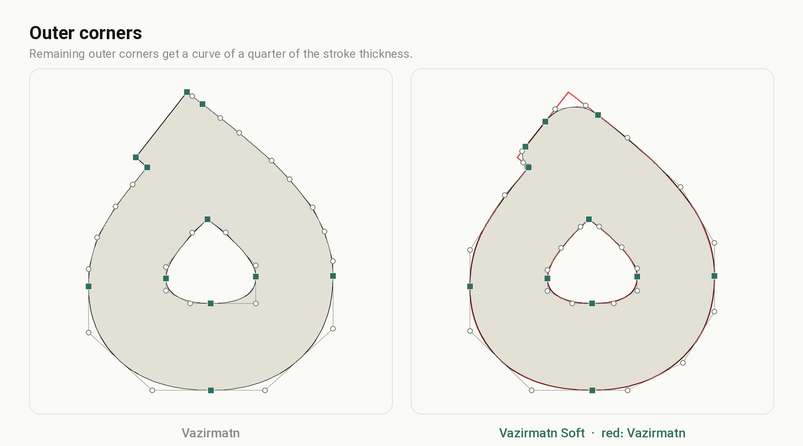

**Inner corners.** Where two straight strokes meet on the inside, for example inside the head of ک, the corner gets a smaller curve (a sixth of the stroke thickness), so the counters look soft without filling in.

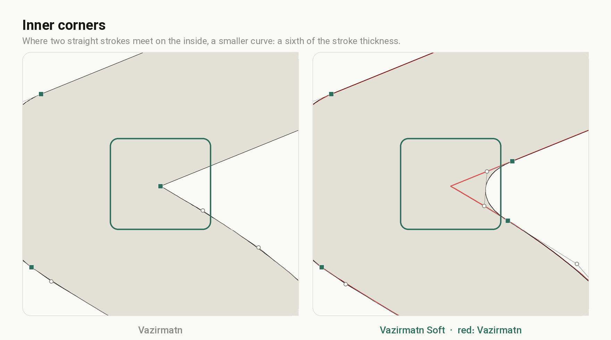

**Where a bowl meets the baseline.** At the junction where a curved bowl joins the straight baseline stroke (under ش, ص, ن and similar letters), the softening curve follows the direction of the bowl, so it flows in without a step or spike.

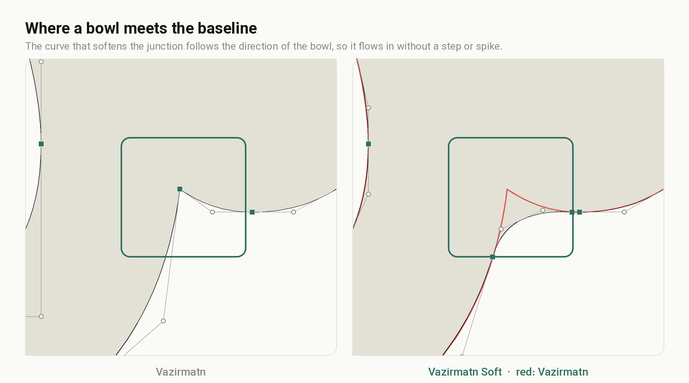

**Joins between letters stay square.** Persian letters connect along the baseline. The edges where one letter meets the next are never rounded, because a round edge there would show as a notch between letters. That includes the short connecting pieces inside joined forms, such as initial پ, medial ی and final ر, so words like *پیش*, *وزیرمتن* and *نرم* join as one smooth stroke in every weight. Corners hidden inside another stroke are also left alone, since rounding them would cut a dent.

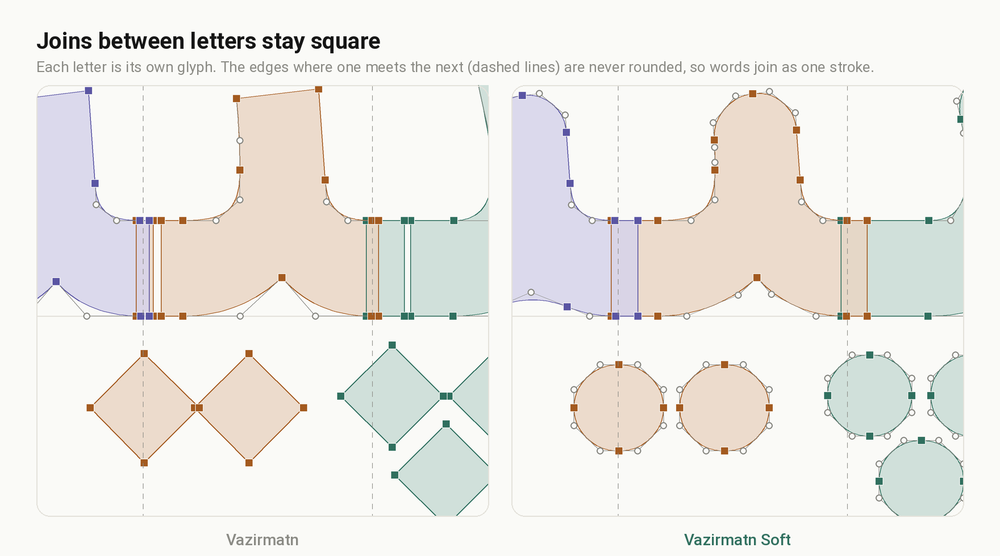

**Deeper overlap at joins.** Each joined letter is a separate glyph, and neighbours overlap slightly where they connect. Some renderers draw each glyph on its own, and when that overlap is less than a pixel they leave a faint light line at the join at small sizes; this happens with the original Vazirmatn too. In Vazirmatn Soft the connecting stroke coming from the right reaches 64 units under the next letter instead of 20. That depth was measured to stay hidden inside the receiving letter in every weight, so nothing new shows. Edges on the other side keep Vazirmatn's 20 units, because some letters (such as final م) are only solid that far in.

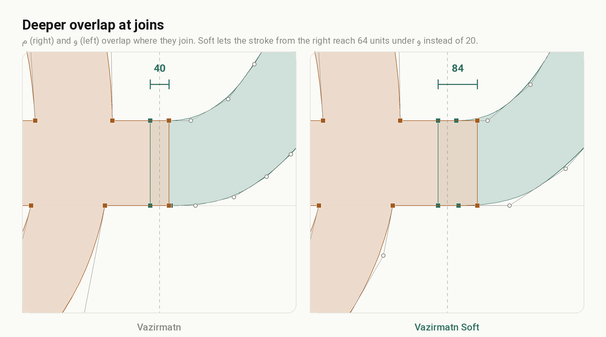

**Bowl tails.** The tail tips of س ش ص ض ن ی ل ق (isolated and final forms) sit a little lower, so the bowls look rounder.

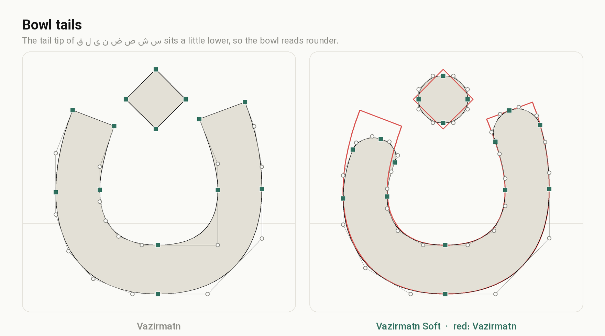

**The گ bar.** The second bar of گ is a pill with two round ends instead of a slanted parallelogram.

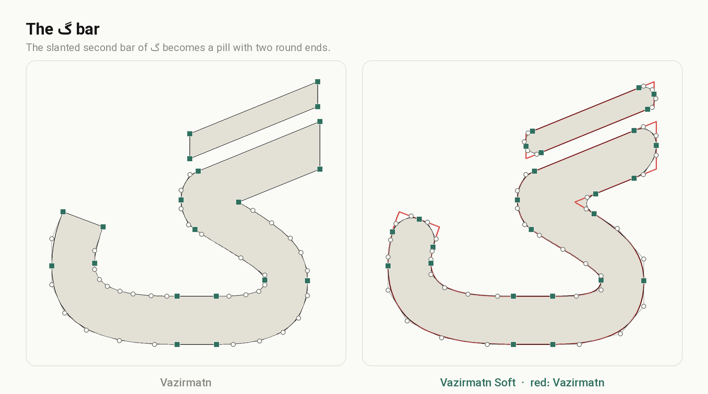

**Digits and punctuation.** ۰ to ۹, « », / % ! ؟ and the other marks get the same round ends and soft corners as the letters.

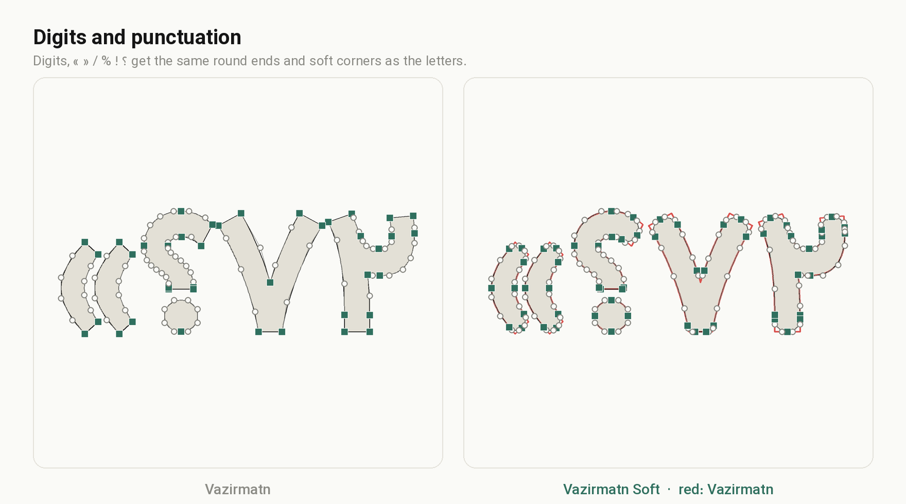

**Left as drawn.** The tatweel (ـ) stays straight so it can stretch letters without bumps. The star ٭ and final ۍ keep their original shape, because rounding them made their outlines overlap in some in-between weights.

**Unchanged.** Shaping, ligatures, kerning, mark positioning, Persian, Arabic, Urdu and Kurdish support, and the Latin letters (from Roboto) are exactly as in Vazirmatn.

**Checked.** Every weight passes FontBakery's universal checks with no failures, has no self-overlapping outlines, and fully supports Persian according to Shaperglot.

## Build from source

`sources/` holds the three masters (Thin, Regular, Black) as UFOs with a designspace, built with Google Fonts' standard tool:

```bash
pip install -r requirements.txt
cd sources && gftools builder config.yaml   # fonts go to fonts/
```

## Credits and license

- **Vazirmatn** by [Saber Rastikerdar](https://github.com/rastikerdar/vazirmatn).
- **Latin** glyphs from [Roboto](https://github.com/googlefonts/roboto-classic) by Christian Robertson.
- **Vazirmatn Soft** by [Matthew](https://github.com/truthofmatthew).

Licensed under the [SIL Open Font License 1.1](OFL.txt), like Vazirmatn. You can use it in personal and commercial work, modify it and share it. Modified versions must stay under the OFL, and the font can't be sold on its own.
